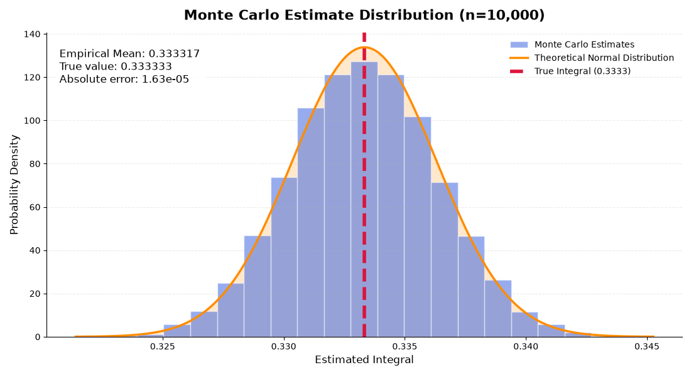
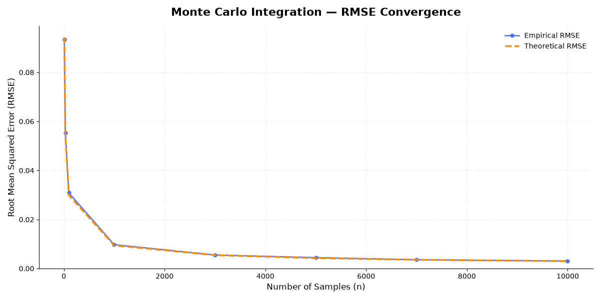

# Monte Carlo Methods

**Numerical integration and statistical inference from first principles — Python, NumPy, SciPy, and Matplotlib**

This project implements a reusable Monte Carlo integration estimator and investigates its statistical properties through reproducible computational experiments. Rather than treating simulation as a black box, it derives the estimator, its sampling variance, convergence behavior, and confidence intervals, then tests those predictions against repeated numerical trials.

**Focus:** mathematical foundations · scientific Python · statistical simulation · uncertainty quantification · automated testing

> **Project scope:** Monte Carlo integration, the Law of Large Numbers (LLN), Central Limit Theorem (CLT), convergence, root mean squared error (RMSE), confidence intervals, and empirical coverage. Importance sampling, variance-reduction techniques, MCMC, and rare-event methods are **not implemented** in this version.

## Results at a glance

Our benchmark is the exactly solvable integral

$$
I=\int_0^1 x^2\,dx=\frac13.
$$

For independent $U_i\sim\mathrm{Uniform}(0,1)$, the Monte Carlo estimator is

$$
\widehat I_n=\frac1n\sum_{i=1}^n U_i^2,
\qquad
\mathrm{Var}(\widehat I_n)=\frac4{45n}.
$$

The following figures are **the actual PNG plots saved in the repository's [figures/](figures/) directory**, not recreated charts. Descriptions distinguish what is directly visible in those figures from theoretical values derived below.

| Experiment | Observation from the saved figures |
| --- | --- |
| CLT / sampling distribution | The histogram of repeated estimates at $n=10{,}000$ closely follows the theoretical normal curve. The figure displays an empirical mean of **0.333317**, compared with the exact value **0.333333**. |
| RMSE convergence | The empirical RMSE line closely tracks the analytical $n^{-1/2}$ prediction over the plotted sample sizes. |
| 95% confidence interval coverage | The graph starts at approximately **92%** coverage for the smallest sample size and approaches/fluctuates around **95%** as sample size grows. |
| Reproducibility | The current experiment code uses fixed seeds; running it in a consistent environment reproduces the same pseudorandom draws. |

### Central Limit Theorem: observed sampling distribution

*Original figure from `figures/CLT.png`. The displayed empirical mean and exact target are annotations produced by the experiment script.*

### RMSE compared with its theoretical prediction

*Original figure from `figures/RMSE_convegence.png`. The theoretical curve follows $\sqrt{4/(45n)}$; the plotted empirical RMSE is calculated from repeated experiments.*

### Coverage of nominal 95% confidence intervals

*Original figure from `figures/Confidence interval convergence.png`. The red reference line marks nominal 95% coverage; the blue line shows observed coverage.*

---

## 1. Motivation: why Monte Carlo integration?

The objective is to approximate a definite integral

$$
I=\int_a^b f(x)\,dx,
$$

possibly when analytical integration is difficult or inconvenient. Monte Carlo methods replace integration by estimating an expectation using random samples.

Let $a<b$ and let $U\sim\mathrm{Uniform}(a,b)$, with density

$$
p(u)=\begin{cases}
\frac{1}{b-a}, & a\leq u\leq b,\\
0, & \text{otherwise}.
\end{cases}
$$

Then

$$
\mathbb E[f(U)]
=\int_a^b f(u)p(u)\,du
=\frac{1}{b-a}\int_a^b f(u)\,du.
$$

Rearranging yields the key identity:

$$
\boxed{I=(b-a)\mathbb E[f(U)]}.
$$

This connects numerical integration to probability and statistical estimation.

### Monte Carlo estimator

Given independent uniform draws $U_1,\dots,U_n$, replace the expectation with a sample mean:

$$
\boxed{
\widehat I_n=\frac{b-a}{n}\sum_{i=1}^{n}f(U_i).
}
$$

The repository's `integrate` function implements this idea with NumPy's random-number generator, and uses a separate estimator function to calculate the sample mean, estimated standard error, and approximate confidence interval.

For reversed integration limits, the implementation swaps the bounds and negates the final estimate. A zero-width interval returns zero.

## 2. Mathematical properties of the estimator

### 2.1 Unbiasedness

Assuming $f(U)$ is integrable, linearity of expectation gives

$$
\begin{aligned}
\mathbb E[\widehat I_n]
&=\frac{b-a}{n}\sum_{i=1}^{n}\mathbb E[f(U_i)]\\
&=(b-a)\mathbb E[f(U)]\\
&=I.
\end{aligned}
$$

Thus the estimator is **unbiased**:

$$
\mathrm{Bias}(\widehat I_n)
=\mathbb E[\widehat I_n]-I=0.
$$

An unbiased estimator is correct *on average across repeated sampling*; a single run can still differ from the true value.

### 2.2 Variance

Assume the draws are independent and $f(U)$ has finite variance

$$
\sigma_f^2=\mathrm{Var}(f(U)).
$$

Then

$$
\begin{aligned}
\mathrm{Var}(\widehat I_n)
&=\mathrm{Var}(\frac{b-a}{n}\sum_{i=1}^{n}f(U_i))\\
&=\frac{(b-a)^2}{n^2}\sum_{i=1}^{n}\mathrm{Var}(f(U_i))\\
&=\boxed{\frac{(b-a)^2\sigma_f^2}{n}}.
\end{aligned}
$$

Therefore the theoretical **standard error** is

$$
\boxed{
\mathrm{SE}(\widehat I_n)
=\frac{(b-a)\sigma_f}{\sqrt n}.
}
$$

**Practical implication:** quadrupling the sample count halves the standard error; reducing it by a factor of ten requires about 100 times as many samples.

### 2.3 Estimating uncertainty from data

Since $\sigma_f$ is usually unknown, the implementation estimates it with the sample standard deviation:

$$
\overline f=\frac1n\sum_{i=1}^{n}f(U_i),
\qquad
s_f^2=\frac1{n-1}\sum_{i=1}^{n}(f(U_i)-\overline f)^2.
$$

The resulting estimated standard error is

$$
\boxed{
\widehat{\mathrm{SE}}(\widehat I_n)
=\frac{(b-a)s_f}{\sqrt n}.
}
$$

This explains why the estimator requires at least two observations.

### 2.4 Exact benchmark calculation

With $f(x)=x^2$ on $[0,1]$,

$$
\mathbb E[U^2]=\int_0^1u^2\,du=\frac13,
\qquad
\mathbb E[U^4]=\int_0^1u^4\,du=\frac15.
$$

Therefore

$$
\begin{aligned}
\mathrm{Var}(U^2)
&=\mathbb E[U^4]-\big(\mathbb E[U^2]\big)^2\\
&=\frac15-\frac19
=\boxed{\frac4{45}}.
\end{aligned}
$$

For the benchmark estimator,

$$
\boxed{\mathbb E[\widehat I_n]=\frac13},
\qquad
\boxed{\mathrm{Var}(\widehat I_n)=\frac4{45n}},
\qquad
\boxed{\mathrm{SE}(\widehat I_n)=\sqrt{\frac4{45n}}}.
$$

These identities supply ground truth for every experiment below; the reference values are **derived**, not estimated from the same simulation being evaluated.

---

## 3. Convergence: the Law of Large Numbers

For i.i.d. variables with finite absolute expectation, the strong Law of Large Numbers states

$$
\frac1n\sum_{i=1}^{n}f(U_i)
\xrightarrow{\text{a.s.}}\mathbb E[f(U)].
$$

Consequently,

$$
\boxed{\widehat I_n\xrightarrow{\text{a.s.}}I}.
$$

The estimator approaches the true integral as the sample count grows, though individual sample paths do not have to improve monotonically.

**Implemented experiments:**

- `experiments/lln.py` visualizes running sample means for **normal**, **uniform**, and **Bernoulli** distributions, alongside their theoretical expectations.
- `experiments/convergence.py` plots Monte Carlo estimates of $\int_0^1x^2\,dx$ for increasing sample sizes, with a horizontal reference line at $1/3$.
- A separate plot tracks the absolute error $|\widehat I_n-I|$ on logarithmic axes.

The original convergence and absolute-error figures are:

*Original figure: `figures/Integral Estimation.png`.*

*Original figure: `figures/Absolute error (Intergral Estimation).png` (filename preserved as committed).*

An important distinction: an observed error for one run is noisy. To study an estimator's typical error rate, repeated simulations are more informative.

## 4. Sampling distributions and the Central Limit Theorem

If $0<\sigma_f^2<\infty$, the Central Limit Theorem gives

$$
\boxed{
\frac{\sqrt n(\widehat I_n-I)}{(b-a)\sigma_f}
\xrightarrow{d}\mathcal N(0,1).
}
$$

For large $n$, the estimator's sampling distribution is approximately

$$
\widehat I_n\ \dot\sim\
\mathcal N(I,\frac{(b-a)^2\sigma_f^2}{n}).
$$

In the benchmark case,

$$
\boxed{
\widehat I_n\ \dot\sim\
\mathcal N(\frac13,\frac4{45n}).
}
$$

**Experiment:** generate 10,000 complete Monte Carlo estimates, each based on $n=10{,}000$ independent uniform draws; plot the histogram; overlay the normal density calculated using the **theoretical** mean and standard deviation.

The saved CLT image prints the empirical mean **0.333317** and the exact value **0.333333**. The theoretical sampling standard deviation at this sample size is

$$
\sqrt{\frac4{45(10{,}000)}}\approx0.002981.
$$

This standard deviation is an **analytical prediction**, not a separately reported measurement in the screenshot. The histogram's agreement with the curve provides numerical evidence for the large-sample approximation. A single large-$n$ histogram is **not** a proof of the CLT or a complete assessment of convergence to normality.

**LLN vs. CLT:** the LLN tells us *where* estimates concentrate; the CLT describes the approximate *distribution of their scaled fluctuations*.

## 5. RMSE and the $n^{-1/2}$ convergence rate

Root mean squared error quantifies typical estimation error relative to the exact target:

$$
\mathrm{RMSE}(\widehat I_n)
=\sqrt{\mathbb E[(\widehat I_n-I)^2]}.
$$

By the bias–variance identity,

$$
\mathrm{RMSE}^2(\widehat I_n)
=\mathrm{Var}(\widehat I_n)
+\mathrm{Bias}(\widehat I_n)^2.
$$

Because ordinary Monte Carlo integration is unbiased under the stated assumptions,

$$
\boxed{
\mathrm{RMSE}(\widehat I_n)
=\mathrm{SE}(\widehat I_n)
=\sqrt{\frac4{45n}}.
}
$$

To estimate RMSE empirically from $R$ repeated trials, the experiment computes

$$
\widehat{\mathrm{RMSE}}
=\sqrt{\frac1R\sum_{r=1}^{R}(\widehat I_n^{(r)}-I)^2}.
$$

This is a **statistical estimate of RMSE**, so it fluctuates slightly across finite collections of trials.

### RMSE results and interpretation

The original [RMSE figure](figures/RMSE_convegence.png) plots empirical RMSE alongside the theoretical prediction $\sqrt{4/(45n)}$ at the eight sample sizes defined in `experiments/convergence.py`, with 1,000 repeated integrations per sample size.

For reference, the **theoretical** RMSE values derived from the formula are:

| Samples $n$ | Theoretical RMSE $\sqrt{4/(45n)}$ |
| ---: | ---: |
| 10 | 0.094281 |
| 100 | 0.029814 |
| 1,000 | 0.009428 |
| 10,000 | 0.002981 |

These are **calculated theoretical values**, not empirical measurements taken from the image. The saved figure provides the empirical comparison; this repository does not currently commit a machine-readable CSV containing the individual trial results.

## 6. Confidence intervals: deriving and testing coverage

The implementation returns a two-sided large-sample confidence interval

$$
\boxed{
\widehat I_n \pm z_{1-\alpha/2}\,
\widehat{\mathrm{SE}}(\widehat I_n)
}
$$

with a normal quantile computed by `scipy.stats.norm.ppf`. At confidence level $1-\alpha=0.95$, this is approximately

$$
\widehat I_n\pm1.96\,\widehat{\mathrm{SE}}(\widehat I_n).
$$

The **nominal** 95% level refers to long-run coverage under a suitable approximation; it does *not* mean a particular fixed interval has a 95% probability of containing an already fixed integral in the usual frequentist interpretation.

### Empirical coverage

For each sample size, the project constructs $R=1{,}000$ intervals and measures

$$
\widehat C_R
=\frac1R\sum_{r=1}^{R}
\mathbf 1\!\{L_r\le I\le U_r\}.
$$

In the original saved plot, coverage is approximately **92% at $n=10** and fluctuates around the nominal 95% target for larger $n$. These are visual readings from the plotted figure, not exact values taken from a saved CSV.

This also demonstrates a limitation: at small sample sizes, **estimated variance and the normal approximation can produce undercoverage**, even though the estimator itself is unbiased.

Coverage estimates have their own sampling uncertainty. If the true coverage were exactly 0.95, the standard deviation of the measured fraction from 1,000 independent repetitions would be

$$
\mathrm{SE}(\widehat C_R)
=\sqrt{\frac{0.95(1-0.95)}{1000}}
\approx0.0069,
$$

or about **0.69 percentage points**. Consequently, small deviations from 95% at large $n$ are not surprising.

---

## 7. Implementation and software design

The core library separates the sampling/integration step from the statistical summary:

- `src/monte_carlo/mc_integration.py` — uniform sampling and signed integral estimates.
- `src/monte_carlo/mc_estimation.py` — generic sample-mean estimator, estimated SE, and normal-based interval.
- `src/monte_carlo/monte_carlo_result.py` — result container (estimate, SE, interval, confidence level, sample count).
- `experiments/lln.py` — LLN demonstration with a command-line interface.
- `experiments/convergence.py` — convergence, CLT, RMSE, and coverage visualizations.
- `tests/` — unit tests for basic behavior, mathematical checks, invalid inputs, interval orientation, and deterministic integration given a fixed seed.

The implementation accepts vectorized integrands acting on a NumPy array. It validates bounds, sample counts, confidence levels, and nonfinite integrand outputs. A scalar integrand output is supported for constant functions.

### Time and space complexity

For one integration run using $n$ samples, the sampling and NumPy-array computations require **$O(n)$ time and $O(n)$ working memory**, excluding any additional cost of evaluating $f$.

For $R$ repeated runs of $n$ samples each, the total time is **$O(Rn)$**, and the stored result list requires **$O(R)$** memory, in addition to a single run's temporary arrays.

### Deterministic random-number design

- The single-run convergence study uses a fixed seed of **69**.
- Repeated experiments initialize one master NumPy generator with seed **42**.
- Each repetition receives a different seed drawn from that master generator, then constructs its own NumPy generator.

This preserves distinct pseudorandom trials while making a repeated execution deterministic under a consistent NumPy random-number implementation. The same master seed is reused for each sample-size study, so results at different sample sizes should not be interpreted as mutually independent experiments.

**Caution:** the repository does not pin exact dependency versions. Byte-for-byte reproducibility across different Python/NumPy environments is not guaranteed.

## 8. Getting started

Requires **Python 3.12+** and a desktop environment for interactive Matplotlib windows.

Clone the repository, install the package locally, and install the test runner:

~~~bash
git clone https://github.com/zionmizrahi4-design/Monte-Carlo-Methods.git
cd Monte-Carlo-Methods

python -m venv .venv
source .venv/bin/activate
python -m pip install --upgrade pip
python -m pip install -e .
python -m pip install pytest
~~~

### Library example

~~~python
from monte_carlo import integrate

result = integrate(
    lambda x: x**2,
    lower_limit=0.0,
    upper_limit=1.0,
    num_of_samples=100_000,
    confidence=0.95,
    seed=42,
)

print(f"Estimate: {result.estimate:.6f}")
print(f"Estimated SE: {result.standard_error:.6f}")
print(f"95% CI: {result.confidence_interval}")
print(f"Exact answer: {1 / 3:.6f}")
~~~

### Reproduce the experiments

Run from the repository root, after installing with `pip install -e .`:

~~~bash
# Law of Large Numbers: normal, uniform, or Bernoulli samples
python experiments/lln.py normal --n 1000 --seed 42
python experiments/lln.py uniform --n 1000 --seed 42 --low 0 --high 1
python experiments/lln.py bernoulli --n 1000 --seed 42 --p 0.5

# Integration, convergence, sampling distribution, RMSE, and coverage
python experiments/convergence.py

# Run all automated tests
python -m pytest -q
~~~

The convergence script opens five Matplotlib plots using `plt.show()`; close each window to proceed to the next. Its large repeated experiments may require substantial computation.

The figures embedded above are the **original PNG files checked into the repository's `figures/` directory**. The script currently opens plots interactively rather than automatically writing image files. To regenerate the plots, run the experiment and save the displayed figures if you want to replace the committed PNGs.

## 9. Assumptions, limitations, and interpretation

**Statistical assumptions**

1. Uniform samples in each estimate are i.i.d. pseudorandom draws.
2. For unbiasedness and LLN conclusions, the integrand must be integrable under the uniform sampling distribution.
3. For the variance formula and classical CLT, $f(U)$ must have finite variance; the nondegenerate standardized CLT also requires positive variance.
4. The confidence interval uses a *large-sample normal approximation*, not an exact small-sample interval.

**Scope and tradeoffs**

- The implemented integration routine is **one-dimensional** and uses **uniform sampling**; it does not attempt advanced sampling schemes.
- Error decreases at the $O(n^{-1/2})$ rate for the finite-variance benchmark, so high precision can be computationally expensive.
- Large or poorly behaved integrand values can produce unstable finite-sample estimates and unreliable confidence intervals.
- The code is intended to teach estimator design and statistical validation, not to outperform specialized deterministic quadrature.
- The experiment demonstrates agreement with CLT predictions at a large sample size but does not numerically establish how rapidly the normal approximation becomes accurate across different integrands.

## 10. What this project demonstrates

This project connects mathematical statistics to practical scientific computing:

1. Derive an estimator from a probability identity and verify unbiasedness analytically.
2. Derive its variance and expected convergence rate.
3. Implement the estimator with NumPy rather than using an existing Monte Carlo integration black box.
4. Design repeated experiments that compare measured outcomes with independently derived theoretical predictions.
5. Quantify uncertainty with estimated standard errors and coverage experiments.
6. Organize simulations, validation, and automated tests into a reusable Python repository.

**Relevant skills:** statistical estimation, numerical methods, probability theory, scientific Python, experiment design, uncertainty quantification, testing, and reproducibility.

---

*Methodological note: empirical observations quoted above are drawn from the original committed figures or their visible annotations. Numerical theoretical predictions are derived from the exact benchmark formulas. No separately generated empirical table is presented as if it were sourced from those figures.*
